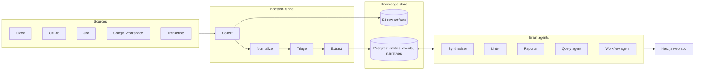

# Architecture

second-brain is an LLM-maintained knowledge base for an engineering organization:
it continuously ingests the places where work actually happens (Slack, GitLab,
Jira, Google Workspace, meeting transcripts), distills them into typed events,
and synthesizes always-current project narratives, dashboards, and reports —
with every claim traceable to its source.

## The shape of the system

## Core decisions

- **Events are the atomic unit.** Extraction turns raw source material into
  typed events (decision, blocker_raised, status_change, deadline_set, …),
  each with confidence, provenance (raw artifact + permalink), and project
  links. Narratives cite events inline (`[event:<uuid>]`), so every sentence
  in a status page drills down to its source.
- **Reject-only trust model.** Agent output applies automatically; humans
  reject or revert rather than approve. Outbound actions (messages, emails,
  issue creation) are the exception — those require explicit approval.
- **Staged funnel for cost control.** Cheap heuristics and a small classifier
  triage the firehose; expensive extraction runs only on what survives.
  Raw artifacts are immutable in S3 and replayable end to end.
- **GitLab is the system of record for work items.** The brain mirrors and
  links; the Linter flags drift between narrative claims and tracker state.
- **Two query paths.** Fast Postgres full-text search for lookups; an async
  agent query for synthesized answers with citations.

## Components

| Path | Runtime | Role |
|---|---|---|
| `web/` | Next.js (App Runner) | dashboards, project detail, activity feed, search, agent query, artifact studio |
| `worker/` | Node (ECS Fargate) | SQS consumers: funnel stages, connectors, agents, digest |
| `packages/schema/` | shared | Drizzle schema + migrations, event taxonomy, job envelope |
| `infra/` | OpenTofu/Terraform | the whole AWS account: VPC, RDS Postgres, S3, SQS, ECR, App Runner, Fargate, CI OIDC role |

All LLM calls route through a gateway (LiteLLM-compatible) with per-agent
model tiers and budget caps — no direct provider SDK use.

## Local development

`docker compose` stands in for every cloud dependency: Postgres 18, MinIO
(S3), ElasticMQ (SQS). `pnpm dev` boots the stack, migrates, and runs web +
worker with health checks on the homepage. No cloud credentials needed.
